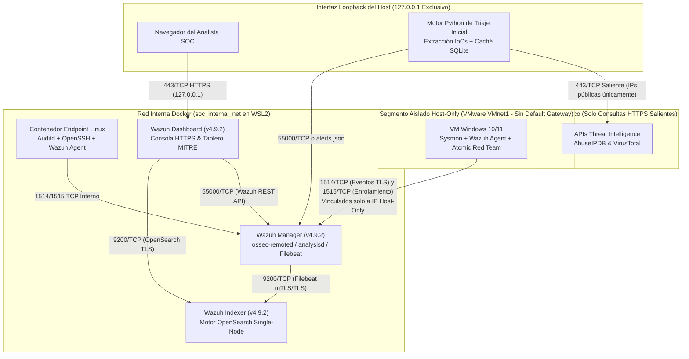

# Arquitectura Técnica, Segmentación de Red y Decisiones de Seguridad

Este documento detalla la arquitectura de referencia del **Laboratorio SOC, Detection Engineering y Triaje Automatizado**, justificando cada decisión de diseño desde una perspectiva de seguridad defensiva (*Defense-in-Depth*) y operación real en un SOC.

---

## 1. Topología Lógica y Aislamiento de Red

El diseño evita dos anti-patrones frecuentes en laboratorios domésticos: virtualizar innecesariamente múltiples servidores pesados que degradan el equipo y publicar puertos de administración SIEM en `0.0.0.0` (exponiéndolos a la red Wi-Fi/LAN local).

### Reglas de Segmentación Aplicadas

1. **Aislamiento de Endpoints de Emulación (`Host-Only`):**
   * La máquina virtual Windows reside en un adaptador virtual **Host-Only** (`VMnet1` en VMware Workstation, ej. subred RFC 1918 `192.168.x.0/24` sin puerta de enlace predeterminada).
   * Durante la instalación inicial de herramientas se habilita temporalmente un adaptador NAT secundario y **se desconecta obligatoriamente antes de ejecutar cualquier prueba de Atomic Red Team**, garantizando contención total.
2. **Vinculación Selectiva por Interfaz en Docker (`Least Privilege Networking`):**
   * A diferencia de la plantilla por defecto de Docker (`0.0.0.0:puerto`), `infrastructure/docker-compose.yml` restringe explícitamente qué interfaz física o virtual escucha cada puerto.

---

## 2. Matriz de Puertos, Protocolos y Superficie de Exposición

| Servicio / Contenedor | Puerto y Protocolo | Interfaz de Escucha en Host | Función Operativa y Justificación de Seguridad |
| :--- | :--- | :--- | :--- |
| **Wazuh Manager (Eventos)** | `1514 / TCP` | `${WAZUH_AGENT_BIND_IP}` (*Host-Only*) | Canal cifrado continuo por donde los agentes envían telemetría (Sysmon, Security, Auditd). Inaccesible desde la red Wi-Fi. |
| **Wazuh Manager (Authd)** | `1515 / TCP` | `${WAZUH_AGENT_BIND_IP}` (*Host-Only*) | Servicio de registro inicial para emitir claves simétricas/certificados únicos a los agentes autorizados. |
| **Wazuh Server REST API** | `55000 / TCP` | `127.0.0.1` (*Loopback*) | Consulta programática de alertas y estado de agentes desde el motor de triaje en Python. Bloqueado fuera del host. |
| **Wazuh Indexer** | `9200 / TCP` | `127.0.0.1` (*Loopback*) | API REST de OpenSearch protegida con TLS y hashes `bcrypt` personalizados. |
| **Wazuh Dashboard** | `443 / TCP` (`-> 5601`) | `127.0.0.1` (*Loopback*) | Consola web HTTPS para monitoreo, *Threat Hunting* y visualización de cobertura MITRE ATT&CK. |
| **Syslog Sin Cifrar (`514/UDP`)** | *Deshabilitado* | *Ninguna* | Omitido deliberadamente respecto a la plantilla base de Wazuh para reducir superficie de ataque y exigir transporte TCP cifrado (`1514`). |

---

## 3. Decisiones Clave de Ingeniería (ADR)

### ADR-01: Gestión Cero-Secretos y Rotación Automatizada Pre-Arranque
* **Problema:** El repositorio oficial `wazuh-docker` incluye contraseñas predeterminadas públicas (`SecretPassword` y `MyS3cr37P450r.*-`) tanto en `docker-compose.yml` como en hashes estáticos dentro de `internal_users.yml` y en texto plano en `wazuh.yml`.
* **Decisión:** Se versiona únicamente la plantilla parametrizada `internal_users.yml.template` (con formato LF estricto vía `.gitattributes`). El script `infrastructure/scripts/setup-lab-env.ps1` genera contraseñas criptográficamente aleatorias en `.env` (UTF-8 sin BOM), invoca `hash.sh` de `wazuh-indexer` pasando el secreto por variable de entorno efímera para calcular los hashes `bcrypt` de `internal_users.yml` (ignorado en Git) y delega la configuración del conector API del Dashboard al script nativo `/wazuh_app_config.sh` mediante variables de entorno.

### ADR-02: Ajuste de Kernel `vm.max_map_count=262144`
* **Contexto técnico:** **Wazuh Indexer** está construido sobre Apache Lucene / OpenSearch, el cual utiliza archivos mapeados en memoria virtual (`mmap`) de forma intensiva para consultar segmentos de índices invertidos a baja latencia. El valor predeterminado en muchas distribuciones Linux (`65530`) provoca fallos de asignación de memoria (`OutOfMemoryError: Map failed`) y aborta el arranque del indexador.

### ADR-03: Activación Controlada de `<logall_json>yes</logall_json>` en Laboratorio
* **Contexto técnico:** Por defecto, Wazuh solo escribe en `alerts.json` aquellos eventos que ya dispararon una regla con severidad igual o superior a `log_alert_level` (nivel 3). En un laboratorio de **Detection Engineering**, necesitamos capturar en `/var/ossec/logs/archives/archives.json` la telemetría cruda exacta generada por **Sysmon** y **Atomic Red Team** *antes* de escribir nuestras reglas personalizadas en la Fase 4.
* **Consideración de producción:** En un entorno corporativo con miles de endpoints, `logall_json` multiplica el consumo de IOPS y disco; en producción solo debe activarse si existe rotación estricta y envío a almacenamiento frío (*cold storage* / S3) por requisitos regulatorios o forenses.

### ADR-04: Inyección de Reglas vía `/wazuh-config-mount/etc/rules` (*Detection-as-Code*)
* **Decisión:** Se monta el directorio `../detections/wazuh-rules:/wazuh-config-mount/etc/rules:ro` en lugar de montar directamente sobre `/var/ossec/etc/rules`. En la imagen oficial `wazuh-manager`, `/var/ossec/etc` es un volumen persistente inicializado por `/etc/cont-init.d/0-wazuh-init` únicamente si el directorio está vacío; montar un subdirectorio directamente dentro de `/var/ossec/etc` en el primer arranque impediría la copia inicial de `decoders/`, `lists/` e `internal_options.conf`. Usar `/wazuh-config-mount/etc/rules` respeta el ciclo `s6-overlay` oficial y propaga limpiamente `local_rules.xml` en cada inicio/reinicio del Manager.

---

## 4. Limitaciones Conocidas del Entorno y Evolución Empresarial

Demostrar criterio de ingeniería implica reconocer las diferencias entre un laboratorio *Single-Node* y una arquitectura de producción:

1. **Alta Disponibilidad (HA) y Resiliencia:** Este despliegue ejecuta un único nodo de Manager e Indexer. En un SOC empresarial (>500 endpoints) se despliega un clúster multi-nodo con nodos *Master/Worker* de Wazuh detrás de un balanceador de carga (ej. NGINX/HAProxy) y al menos 3 nodos de OpenSearch con réplicas de *shards*.
2. **Volumen y Diversidad de Tráfico:** La línea base del laboratorio proviene de actividad administrativa controlada, no de miles de usuarios simultáneos. Las excepciones de *tuning* (Fase 5) se diseñan bajo el principio de mínimo privilegio para evitar sobre-ajustar (*overfitting*) las reglas al entorno de prueba.
3. **Gestión Empresarial de Secretos:** Mientras que aquí utilizamos variables de entorno locales protegidas por permisos de archivo, en producción las claves de API CTI y credenciales del clúster deben inyectarse desde un gestor dedicado (HashiCorp Vault, AWS Secrets Manager o Azure Key Vault) y los certificados TLS deben ser emitidos por una PKI corporativa interna.
